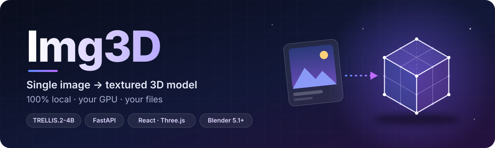
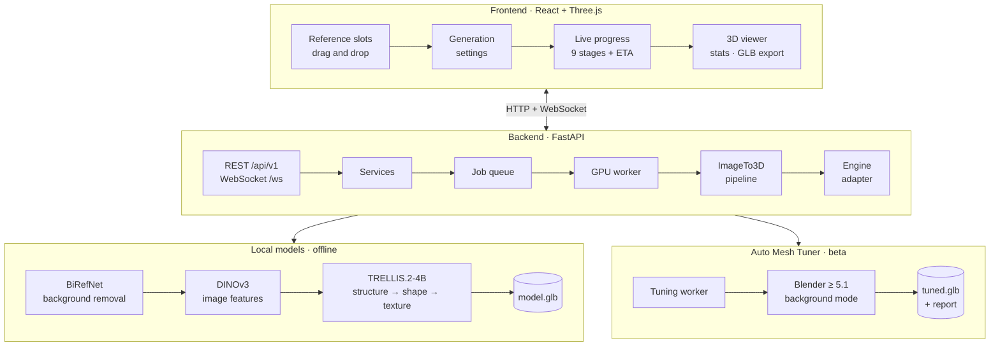

<div align="center">



<h3>Turn a single image into a textured, download-ready 3D model — entirely on your own GPU.</h3>

<p>
  <a href="LICENSE"></a>
  
  
</p>
<p>
  
  
  
  
  
  
  
  
  <a href="https://huggingface.co/microsoft/TRELLIS.2-4B"></a>
</p>

<p>
  <a href="#-features">Features</a> •
  <a href="#-how-it-works">How it works</a> •
  <a href="#-requirements">Requirements</a> •
  <a href="#-setup">Setup</a> •
  <a href="#-usage">Usage</a> •
  <a href="#-api">API</a> •
  <a href="#-license">License</a>
</p>

</div>

---

**Img3D** is a local, production-style image-to-3D studio. Drop in a character or object image and it produces a
textured **GLB** mesh with Microsoft's [**TRELLIS.2-4B**](https://huggingface.co/microsoft/TRELLIS.2-4B), shows live
progress, lets you inspect the result in a real-time 3D viewer and — optionally — cleans the mesh up in
**Blender** with the experimental *Auto Mesh Tuner*. No cloud, no uploads to third parties: after setup it runs
fully offline.

> [!IMPORTANT]
> Img3D's own code is GPL-3.0, but a working install relies on **nvdiffrast** (NVIDIA, *non-commercial only*) and
> **DINOv3** (Meta, *DINOv3 License*). Read [Licenses & usage terms](#-license) before using it for anything
> commercial.

## ✨ Features

<table>
<tr>
<td width="50%" valign="top">

### 🧊 Generation
- **TRELLIS.2-4B** image-to-3D with PBR textures, run locally
- Resolution **512 / 1024 / 1536**, texture **512 – 4096 px**
- **Polygon target** 5 k – 2 M faces, seed + randomize
- Advanced sampler controls per stage (steps, guidance, rescale)
- Automatic **background removal** (BiRefNet, RMBG-2.0 optional)
- **Async job queue** — the GPU never blocks the API; cancel any time

</td>
<td width="50%" valign="top">

### 🖼️ References
- **Multi-reference** data model: Front, Back, Left, Right, Face Front, Face Side + up to 8 Detail images
- **Primary-image** selection (the engine conditions on it today; the API is ready for multi-view engines)
- Drag & drop upload, validated by decoding (PNG / JPEG / WEBP, ≤ 25 MB)
- Thumbnails, re-slotting, reusable reference sets

</td>
</tr>
<tr>
<td valign="top">

### 👀 Viewer & export
- Real-time **Three.js / React Three Fiber** viewer — orbit, zoom, wireframe and material modes, fullscreen
- **Model statistics**: vertices, faces, materials, textures, UVs, bounding box, file size
- One-click **GLB download** and a **job history** drawer
- **Live progress** over WebSocket: 9 stages, step counter, ETA

</td>
<td valign="top">

### 🛠️ Auto Mesh Tuner *(experimental)*
- Finds every installed **Blender**, runs each to read its real version, picks the best ≥ 5.1
- Optional **official portable Blender** download: SHA-256 verified, resumable, only after you confirm
- 8-step pipeline: analyze → geometry repair (inner-shell removal, holes, islands, normals) → face/eye refinement → topology → rig cleanup → validation → export
- Before/after report, previews and an **Original ↔ Tuned** toggle in the viewer

</td>
</tr>
<tr>
<td valign="top">

### 🖥️ Product polish
- Modern **dark UI**, responsive from desktop to phone (mobile tab bar)
- Engine status with per-component **model-load progress**, GPU/VRAM meter, connection indicator
- Clear error, loading and empty states; toasts
- Optional **login** (single user) for LAN access

</td>
<td valign="top">

### 🧱 Engineering
- Modular **FastAPI** backend with one entry point (`backend/main.py`)
- TRELLIS.2 isolated behind an **engine adapter** — API and services never import `torch`
- Structured JSON logging, typed settings, retention clean-up, graceful shutdown
- Self-contained **embedded Python 3.14** + CUDA 13.4 toolchain from NVIDIA wheels (no system installs)
- **350+ automated tests** (backend, engine, launcher, tuner, frontend contract)

</td>
</tr>
</table>

## 🧠 How it works



**Generation stages** (shown live in the UI): preparing image → encoding image → building structure →
generating geometry → generating texture → decoding mesh → exporting GLB → finalizing.

## 🤗 Models & core libraries

| | Component | Role | Links |
|---|---|---|---|
| 🧊 | **TRELLIS.2-4B** — Microsoft | Image → 3D (4 B-param flow transformers, O-Voxel) | [Model](https://huggingface.co/microsoft/TRELLIS.2-4B) · [Code](https://github.com/microsoft/TRELLIS.2) · [Paper](https://arxiv.org/abs/2512.14692) · [Project](https://microsoft.github.io/TRELLIS.2/) |
| 👁️ | **DINOv3 ViT-L/16** — Meta | Image conditioning features (gated) | [Model](https://huggingface.co/facebook/dinov3-vitl16-pretrain-lvd1689m) · [License](https://ai.meta.com/resources/models-and-libraries/dinov3-license/) |
| 🧱 | **TRELLIS-image-large** — Microsoft | Sparse-structure decoder checkpoint | [Model](https://huggingface.co/microsoft/TRELLIS-image-large) |
| ✂️ | **BiRefNet** — Peng Zheng et al. | Background removal (default, MIT) | [Model](https://huggingface.co/ZhengPeng7/BiRefNet) |
| ✂️ | **RMBG-2.0** — BRIA AI | Background removal (optional, non-commercial) | [Model](https://huggingface.co/briaai/RMBG-2.0) |
| ⚙️ | **CuMesh** · **FlexGEMM** — Jianfeng Xiang | CUDA mesh ops · sparse convolution | [CuMesh](https://github.com/JeffreyXiang/CuMesh) · [FlexGEMM](https://github.com/JeffreyXiang/FlexGEMM) |
| 🎨 | **nvdiffrast** — NVIDIA | Differentiable rasterization (texture baking) | [Code](https://github.com/NVlabs/nvdiffrast) |
| 🔥 | **PyTorch** · **Triton (Windows)** | Tensor runtime · JIT kernels | [PyTorch](https://pytorch.org) · [triton-windows](https://github.com/triton-lang/triton-windows) |
| 🚀 | **FastAPI** · **Pydantic** · **Uvicorn** | Web API | [FastAPI](https://github.com/fastapi/fastapi) · [Pydantic](https://github.com/pydantic/pydantic) · [Uvicorn](https://uvicorn.dev/) |
| ⚛️ | **React** · **Three.js** · **R3F** · **drei** · **Zustand** | UI + 3D viewer | [React](https://github.com/react/react) · [three.js](https://github.com/mrdoob/three.js) · [R3F](https://github.com/pmndrs/react-three-fiber) · [drei](https://github.com/pmndrs/drei) · [Zustand](https://github.com/pmndrs/zustand) |
| 🧰 | **Blender** | Mesh repair runtime (Auto Mesh Tuner) | [blender.org](https://www.blender.org) |

Every dependency with version and license: [**THIRD_PARTY_NOTICES.md**](THIRD_PARTY_NOTICES.md).

## 💻 Requirements

| | Minimum / tested |
|---|---|
| **OS** | Windows 11 x64 (developed and tested on Windows 11 Pro) |
| **GPU** | NVIDIA GPU with **≥ 24 GB VRAM** (TRELLIS.2 upstream requirement). Developed on an **RTX 5090 (32 GB)**; extensions are built for `sm_120` by default |
| **Driver** | NVIDIA driver with **CUDA 13** support (R580 or newer) |
| **Disk** | ≈ 30 GB (models ≈ 18 GB, Python env ≈ 4.4 GB, CUDA toolchain ≈ 1.7 GB, outputs extra) |
| **Build tools** | Visual Studio 2026 (Community or Build Tools) with *Desktop development with C++* (MSVC 14.51) — only to compile the CUDA extensions |
| **Node.js** | Node.js 22 LTS (tested with 22.17) for the frontend |
| **Accounts** | A Hugging Face account with access granted to **DINOv3** |
| **Optional** | Blender ≥ 5.1 for the Auto Mesh Tuner (Img3D can download the official portable build for you) |

> [!NOTE]
> On an RTX 5090, model loading takes ≈ 75–95 s, and a maximum-quality job (1536³, 4K textures, 2 M faces) took
> about 3½–10 minutes. The very first job on a fresh machine is slower while Triton/FlexGEMM tune and cache their kernels.

## 📌 Project status

| Area | Status |
|---|---|
| Backend API, job queue, WebSocket progress, auth | ✅ Done — tested |
| TRELLIS.2 engine adapter, native CUDA extensions, background removal | ✅ Done — verified on RTX 5090 |
| React UI (references, settings, progress, viewer, history, login) | ✅ Done |
| Blender runtime detection / selection / portable download | ✅ Done — tested |
| Auto Mesh Tuner steps (repair, face/eye refinement, topology) | 🧪 In progress — experimental |
| True multi-view conditioning | 🗺️ Planned (data model and API already support it) |

---

## 🚀 Setup

> All commands run in **PowerShell** from the repository root. The backend uses only its own embedded Python —
> never a system Python, venv or conda.

### 1 · Clone with submodules

```powershell
git clone --recursive https://github.com/shiwamshoryasharma/Image-3D-object.git Img3D
cd Img3D
```

The upstream sources (TRELLIS.2, CuMesh, FlexGEMM, nvdiffrast) are pinned Git submodules — see
[`backend/third_party/README.md`](backend/third_party/README.md).

### 2 · Embedded Python 3.14

Set up a self-contained CPython 3.14.2 in `backend/python/` as described in
[`backend/python/README.md`](backend/python/README.md), then install the pinned stack into it:

```powershell
$py = ".\backend\python\python.exe"
& $py -s -m uv pip install --python $py --link-mode=copy -r backend\requirements.txt
```

### 3 · CUDA toolchain + native extensions

Assemble the CUDA 13.4 compiler from NVIDIA's pip wheels into `backend/.toolchain/`
([instructions](backend/.toolchain/README.md)), then build and verify the four extensions:

```powershell
cmd /c backend\scripts\build_extensions.cmd
& $py -s test\env_setup\verify_extensions.py
```

> Not on an RTX 50-series GPU? Set `TORCH_CUDA_ARCH_LIST` (for example `8.9` for RTX 40-series) before building.

### 4 · Models

1. Request access to [DINOv3](https://huggingface.co/facebook/dinov3-vitl16-pretrain-lvd1689m) on Hugging Face
   (and optionally [RMBG-2.0](https://huggingface.co/briaai/RMBG-2.0)).
2. Create `backend/.env` from the template and add your token:

   ```powershell
   Copy-Item backend\.env.example backend\.env
   notepad backend\.env      # HF_TOKEN=hf_...   (optional: UI_USERNAME / UI_PASSWORD)
   ```

3. Download TRELLIS.2-4B and the auxiliary models into `backend/.model/`
   ([details](backend/.model/README.md)):

   ```powershell
   & $py -s -c "from huggingface_hub import snapshot_download; snapshot_download('microsoft/TRELLIS.2-4B', local_dir=r'backend\.model\TRELLIS.2-4B')"
   & $py -s backend\scripts\download_aux_models.py
   ```

### 5 · Frontend

```powershell
cd frontend
npm ci
npm run build      # production UI, served by the backend at http://127.0.0.1:8000
cd ..
```

### 6 · Launch

```powershell
cd backend
.\python\python.exe -s main.py            # flags: --host --port --log-level --no-preload
```

Open **http://127.0.0.1:8000**. For UI development with hot reload run `npm run dev` in `frontend/` and open
**http://localhost:5173** (the Vite dev server proxies `/api` and the WebSocket to the backend).

## 🎮 Usage

1. **Add references** — drag, drop or paste images onto the slots (Front, Back, Left, Right, Face Front,
   Face Side, Detail). Mark the image the engine should use with the ★ **primary** star.
2. **Tune settings** — resolution, texture size, polygon target, seed (or randomize) and, under *Advanced*, the
   sampler steps and guidance of each stage. Background removal is on by default.
3. **Generate** — watch the stage-by-stage progress and ETA; **Cancel** stops the job at the next safe point.
4. **Inspect** — orbit and zoom, switch between material and wireframe, read the model statistics.
5. **Export** — *Download GLB*. Earlier results stay in the **History** drawer.
6. **Auto Tune** *(experimental)* — open the Blender setup from the header pill, pick or download a runtime, then
   press *Auto Tune* on a finished model and compare **Original ↔ Tuned**.

<details>
<summary><b>Auto Mesh Tuner from the command line</b></summary>

```powershell
$py = ".\backend\python\python.exe"
& $py -s backend\scripts\auto_mesh_tuner.py detect                    # list Blender installs + versions
& $py -s backend\scripts\auto_mesh_tuner.py status
& $py -s backend\scripts\auto_mesh_tuner.py select auto|system|embedded [--executable PATH]
& $py -s backend\scripts\auto_mesh_tuner.py download                  # asks before downloading
& $py -s backend\scripts\auto_mesh_tuner.py tune model.glb -o out --preset balanced
```

</details>

<details>
<summary><b>Access from another device on your LAN</b></summary>

`npm run dev` / `npm run preview` listen on all interfaces, so phones and tablets on the same network can open
`http://<your-pc-ip>:5173`. API calls go through the Vite proxy, so the backend stays on `127.0.0.1`.
Set `UI_USERNAME` and `UI_PASSWORD` in `backend/.env` to require a login, and add host names to
`IMG3D_ALLOWED_HOSTS` if needed. Traffic is plain HTTP — keep it on a trusted network.

</details>

## ⚙️ Configuration

All settings come from `backend/.env` (template: [`backend/.env.example`](backend/.env.example)); process
environment variables override the file.

| Variable | Default | Purpose |
|---|---|---|
| `HF_TOKEN` | — | Hugging Face token for the gated model downloads |
| `UI_USERNAME`, `UI_PASSWORD` | — | Turn on the login screen when both are set |
| `IMG3D_HOST`, `IMG3D_PORT` | `127.0.0.1`, `8000` | Backend bind address |
| `IMG3D_ENVIRONMENT` | `development` | `production` disables `/api/docs` |
| `IMG3D_MODEL_DIR` | `.model/TRELLIS.2-4B` | TRELLIS.2 weights |
| `IMG3D_LOW_VRAM` | `true` | Keep idle sub-models off the GPU |
| `IMG3D_ATTENTION_BACKEND` | `auto` | `auto` · `flash_attn` · `xformers` · `sdpa` |
| `IMG3D_PRELOAD_MODEL` | `true` | Load the model at start-up (the API is usable meanwhile) |
| `IMG3D_MAX_UPLOAD_MB` | `25` | Upload size limit |
| `IMG3D_MAX_QUEUE_SIZE` | `16` | Pending jobs |
| `IMG3D_JOB_RETENTION_DAYS` | `14` | Automatic clean-up of old jobs |
| `IMG3D_BLENDER_EXECUTABLE` | — | Force a specific `blender.exe` |
| `IMG3D_BLENDER_MIN_VERSION` | `5.1` | Minimum Blender for the tuner |
| `IMG3D_BLENDER_ALLOW_DOWNLOAD` | `true` | Allow the portable download (always asks first) |

All 50 settings are documented inline in `.env.example`.

## 🔌 API

Interactive docs: **http://127.0.0.1:8000/api/docs** (development mode). All routes are under `/api/v1`;
the full contract lives in [`.claude/skills/img3d-architecture/api-contract.md`](.claude/skills/img3d-architecture/api-contract.md).

| Area | Endpoints |
|---|---|
| Health & system | `GET /health` · `GET /system` · `POST /system/engine/load` · `POST /system/engine/unload` |
| Auth | `GET /auth/status` · `POST /auth/login` · `POST /auth/logout` |
| Reference sets | `POST/GET /reference-sets` · `GET/DELETE /reference-sets/{id}` · `POST /reference-sets/{id}/images` · `PATCH/DELETE …/images/{image_id}` · `PUT /reference-sets/{id}/primary` |
| Jobs | `POST/GET /jobs` · `GET/DELETE /jobs/{id}` · `POST /jobs/{id}/cancel` · `GET /jobs/{id}/result` · `GET /jobs/{id}/preview` · `GET /jobs/{id}/model.glb` · `GET /jobs/{id}/export/glb` |
| Blender runtime | `GET /blender/runtime` · `POST /blender/runtime/detect` · `PUT /blender/runtime/selection` · `POST /blender/runtime/release` · `POST/DELETE /blender/runtime/download` |
| Auto Mesh Tuner | `POST/GET /jobs/{id}/tunings` · `GET/DELETE /tunings/{id}` · `POST /tunings/{id}/cancel` · `GET /tunings/{id}/report` · `…/model.glb` · `…/export/glb` · `…/previews/{name}` · `…/log` |
| Live events | `WS /ws` → `hello`, `job.updated`, `system.updated`, `blender.updated`, `tuning.updated`, `ping` |

<details>
<summary><b>Example: generate from the command line</b></summary>

```powershell
$api = "http://127.0.0.1:8000/api/v1"
$set = Invoke-RestMethod -Method Post "$api/reference-sets" -ContentType "application/json" -Body '{"name":"demo"}'
curl.exe -s -F "file=@my_character.png" -F "slot=front" "$api/reference-sets/$($set.id)/images" | Out-Null
$body = @{ reference_set_id = $set.id; settings = @{ resolution = 1024; texture_size = 2048 } } | ConvertTo-Json
$job  = Invoke-RestMethod -Method Post "$api/jobs" -ContentType "application/json" -Body $body
# poll GET $api/jobs/$($job.id) (or listen on the WebSocket), then:
curl.exe -o model.glb "$api/jobs/$($job.id)/export/glb"
```

</details>

## 🧪 Testing

```powershell
$py = ".\backend\python\python.exe"
& $py -s -m pytest -c test\pytest.ini test\backend test\aux_models test\launcher -q -p no:cacheprovider
& $py -s -m pytest -c test\pytest.ini test\engine -q -p no:cacheprovider
& $py -s test\env_setup\verify_extensions.py        # native CUDA extensions
& $py -s test\engine\run_generation_smoke.py        # real TRELLIS.2 run (needs the models)
cd frontend; npm run lint; npm run build             # oxlint + strict tsc + Vite build
```

Everything test-related — suites, probes, caches, configs — lives in [`test/`](test/README.md).

## 🗂️ Project structure

```text
Img3D/
├── backend/
│   ├── main.py               # the single entry point
│   ├── api/                  # FastAPI routers, deps, WebSocket hub
│   ├── services/             # reference / job / result / system / auth / tuner services
│   ├── workers/              # job queue, GPU generation worker, tuning worker
│   ├── pipelines/            # image-to-3D pipeline, reference strategy, progress
│   ├── inference/            # engine seam + TRELLIS.2 adapter (only place torch is imported)
│   ├── launcher/             # Blender detection / selection / download / process runner (stdlib only)
│   ├── blender_scripts/      # Auto Mesh Tuner — runs inside Blender's Python
│   ├── storage/ processing/ schemas/ models/ core/ config/ utils/
│   ├── scripts/              # build_extensions.cmd, download_aux_models.py, auto_mesh_tuner.py
│   ├── third_party/          # git submodules + build patches
│   ├── python/  .toolchain/  .model/     # local only — README.md in each
│   └── runtime/  logs/       # generated data (gitignored)
├── frontend/                 # React 19 + Vite 8 + TypeScript 6
│   └── src/{api,components,hooks,lib,store,styles}
├── test/                     # all tests, probes, caches and test configs
├── docs/assets/              # README artwork
├── .claude/                  # project memory + skills for Claude Code
├── THIRD_PARTY_NOTICES.md  CONTRIBUTING.md  CODE_OF_CONDUCT.md  SECURITY.md  CITATION.cff
└── LICENSE                   # GPL-3.0
```

## 🧯 Troubleshooting

<details>
<summary><b>Engine shows “unavailable” after start-up</b></summary>

Usually a missing auxiliary model (most often DINOv3 because access has not been granted yet). Run
`backend\python\python.exe -s backend\scripts\download_aux_models.py --check`, fix what it reports, then click
**Retry loading model** in the engine status popover (or `POST /api/v1/system/engine/load`) — no restart needed.
</details>

<details>
<summary><b>Import errors or wrong package versions</b></summary>

Always start the embedded interpreter with `-s`. Without it, the per-user site-packages folder
(`%APPDATA%\Python\Python314\site-packages`) can shadow the pinned packages.
</details>

<details>
<summary><b><code>cudafe++</code> crashes (ACCESS_VIOLATION) while building extensions</b></summary>

Use nvcc **13.4** with MSVC 14.51. nvcc 13.0 crashes with that compiler, and MSVC 14.29 lacks the C++20 support
torch 2.14 needs. See [`backend/third_party/PATCHES.md`](backend/third_party/PATCHES.md).
</details>

<details>
<summary><b>The first generation is very slow</b></summary>

FlexGEMM/Triton tune and JIT-compile kernels on first use (5–30 s per new kernel). The caches live in
`backend/runtime/cache/` — keep them, and later runs are fast.
</details>

<details>
<summary><b>Blender is not detected</b></summary>

Img3D needs Blender ≥ 5.1. Point `IMG3D_BLENDER_EXECUTABLE` at your `blender.exe`, add folders to
`IMG3D_BLENDER_SEARCH_DIRS`, or let Img3D download the official portable build after you confirm.
</details>

## 🛣️ Roadmap

- [x] Local TRELLIS.2 generation, live progress, viewer, history, GLB export
- [x] Blender runtime detection, selection and verified portable download
- [ ] Finish and verify the Auto Mesh Tuner repair / refinement steps on real meshes
- [ ] Live end-to-end validation of Auto Tune from the UI
- [ ] True multi-view conditioning using the existing multi-reference slots

## 📜 License

**Img3D** — Copyright © 2026 **Shiwam Shorya Sharma**.

Img3D is free software: you can redistribute it and/or modify it under the terms of the
**GNU General Public License v3.0** ([LICENSE](LICENSE)). It is distributed in the hope that it will be useful,
but **without any warranty**.

Third-party code, models and tools keep their own licenses and are **not** included in this repository:

| Component | License | Commercial use |
|---|---|---|
| TRELLIS.2 code + TRELLIS.2-4B weights, CuMesh, FlexGEMM, BiRefNet | MIT | ✅ Allowed |
| DINOv3 | [DINOv3 License](https://ai.meta.com/resources/models-and-libraries/dinov3-license/) | ⚠️ Allowed under its terms (acceptable use, trade controls) |
| nvdiffrast | [NVIDIA Source Code License](https://github.com/NVlabs/nvdiffrast/blob/main/LICENSE.txt) | ❌ Non-commercial only |
| RMBG-2.0 (optional) | Bria RMBG-2.0 / CC BY-NC 4.0 | ❌ Non-commercial only |
| Blender | GNU GPL | ✅ (separate program) |

Full details, every Python/npm package and the codes of conduct I follow:
[**THIRD_PARTY_NOTICES.md**](THIRD_PARTY_NOTICES.md). Only use input images you have the rights to use.

## 🙏 Acknowledgements

Img3D would not exist without the work of the **TRELLIS.2** team at Microsoft, **Jianfeng Xiang** (CuMesh,
FlexGEMM), **NVIDIA** (nvdiffrast), **Meta AI** (DINOv3), **Peng Zheng et al.** (BiRefNet), **BRIA AI**
(RMBG-2.0), the **Blender Foundation**, and the PyTorch, Hugging Face, FastAPI, pmndrs and three.js communities.

## 📖 Citation

If Img3D helps your work, please cite it (GitHub: *Cite this repository*, from [`CITATION.cff`](CITATION.cff))
and the model it builds on:

```bibtex
@article{xiang2025trellis2,
  title   = {Native and Compact Structured Latents for 3D Generation},
  author  = {Xiang, Jianfeng and Chen, Xiaoxue and Xu, Sicheng and Wang, Ruicheng and Lv, Zelong and Deng, Yu and
             Zhu, Hongyuan and Dong, Yue and Zhao, Hao and Yuan, Nicholas Jing and Yang, Jiaolong},
  journal = {Tech report},
  year    = {2025}
}
```

## 👤 Author

<table>
<tr>
<td>

**Shiwam Shorya Sharma**<br/>
GitHub: [@shiwamshoryasharma](https://github.com/shiwamshoryasharma)

Contributions are welcome — see [CONTRIBUTING.md](CONTRIBUTING.md), [CODE_OF_CONDUCT.md](CODE_OF_CONDUCT.md) and
[SECURITY.md](SECURITY.md).

</td>
</tr>
</table>

<div align="center">
<sub>Built with TRELLIS.2 · FastAPI · React · Three.js · Blender — runs on your machine, stays on your machine.</sub>
</div>
